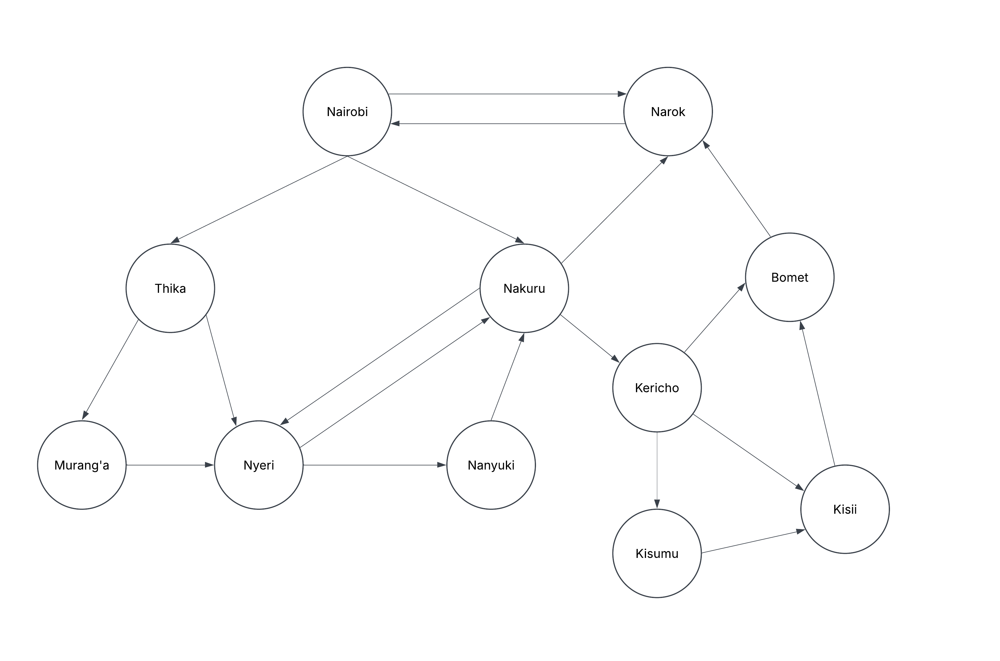
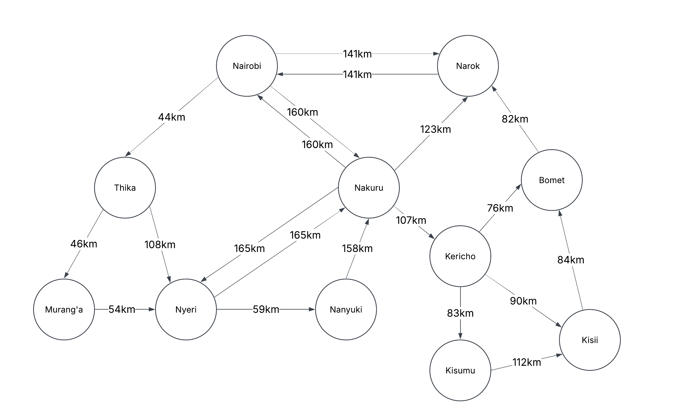

## Q1

### Design the agent using the PEAS framework and further define its environment using the 5 definitions of agent environments.

#### PEAS

- Performance Measure (P) -> Covers the shortest distance possible between the starting point and the destination.
- Environment (E) -> The physical road network, pedestrians, cars, traffic lights, traffic police etc.
- Actuators (A) -> Steering Wheel, wheels, accelerator, brakes, indicators, lights and horn.
- Sensors (S) -> Camera, LIDAR sensors, GPS module and speedometer.

#### Agent Environments

- Partially observable -> The trailer cannot accurately detect everything around it such as pedestrians that maybe hidden behind a car or a sensor may fail to detect an obstacle.
- Stochastic -> The trailer cannot predict every event on the road. Other drivers may brake suddenly or pedestrians may cross unexpectedly among other unexpected occurences.
- Sequential -> The trailer's actions have consequences since a present action affects future decisions such as choosing a specific path determines its route.
- Dynamic -> Road conditions and traffic can change continuously such as other vehicles moving, pedestrians crossing roads, traffic lights changing, and unexpected obstacles appearing.
- Multi Agent -> It is a multi-agent environment since the environment has more than one agent interacting with the environment such as other self-driving vehicles.

## Q2

### Develop a suitable directed graph and search tree based on the map presented in class of Kenya’s Highway Network featuring cities and towns in the Nairobi, Central Highlands, Rift Valley and Lake Victoria Basin regions. For reference, you can use this Google Maps view to generate the graph and tree. The tree should apply the concept of abstraction as discussed in class.

#### Directed Graph

#### Search Tree

## Q3

### Using distance between towns as the path cost function, determine the optimal path the trailer can take from Nairobi to Kisumu. Calculate the distance between towns using this Google Maps search feature.

#### Cost Graph

#### Calculations

Optimal path (Nairobi to Kisumu) = Nairobi -> Nakuru -> Kericho -> Kisumu = 160 + 107 + 83 = 350 km

## Team Photo

